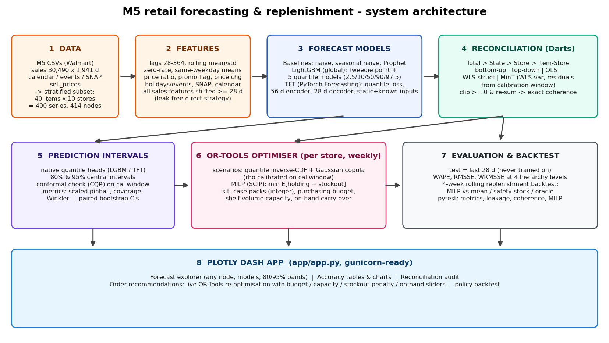

# M5 Retail Demand Forecasting & Replenishment

End-to-end pipeline on the real **M5 (Walmart)** data (official Kaggle files; the whole pipeline is executed by `scripts/run_all.sh`):
features -> baselines (naive, Prophet) -> **LightGBM** + **Temporal Fusion Transformer** (2 models) -> **ensemble** -> **hierarchical reconciliation (Darts)** ->
**calibrated prediction intervals** -> **OR-Tools order optimisation** -> **Plotly Dash** app.



## Headline results (held-out test window d1914-d1941; nothing was selected, tuned or calibrated on it)
| | WAPE Total | WAPE State | WAPE Store | WAPE item-store | RMSSE item-store | 80% / 95% coverage (item-store) |
|---|---|---|---|---|---|---|
| Seasonal naive | 0.185 | 0.202 | 0.236 | 0.884 | 0.971 | 0.78 / 0.86 |
| Prophet (+holidays, SNAP, price) | 0.143 | 0.140 | 0.205 | 0.812 | 0.812 | 0.76 / 0.89 |
| LightGBM + MinT (previous version) | 0.099 | 0.119 | 0.155 | 0.696 | 0.736 | 0.82 / 0.97 |
| **Ensemble + MinT (final)** | 0.110 | 0.126 | 0.160 | 0.685 | 0.734 | 0.80 / 0.95 |
| TFT, avg of 2 (item level only) | - | - | - | 0.662 | 0.782 | 0.48 / 0.57 raw |

* **Ensemble + MinT vs Prophet**: WAPE gain +0.127, 95% CI [+0.083, +0.174] (paired bootstrap over series).
* **Ensemble + MinT vs the previous version of this project**: item-level WAPE gain +0.011, 95% CI [+0.001, +0.020] (1.6% relative). RMSSE is level. **Top levels are slightly worse**
  (Total 0.110 vs 0.099, Store 0.160 vs 0.155) - a real trade-off, not hidden. Details and all other models in [`docs/RESULTS.md`](docs/RESULTS.md).
* **Prediction intervals**: final ensemble coverage 0.80 / 0.95 (nominal 0.80 / 0.95) after conformal recalibration on the calibration window; scaled pinball loss 0.213 (Prophet 0.255, seasonal naive 0.317).
  *Correction of an earlier claim:* raw TFT intervals look badly under-covered (0.48 / 0.57) only because TFT's lower bounds are strictly positive (e.g. 0.0004) while demand is often exactly 0; recalibration brings TFT to 0.80 / 0.95.
* **Reconciliation**: all methods give exact coherence (gap ~1e-13, `results/coherence_audit.csv`). Its effect on accuracy is mixed (LightGBM Total WAPE 0.121 -> 0.098, Item 0.688 -> 0.694; ensemble Total 0.121 -> 0.110, Item 0.669 -> 0.685). You pay a little accuracy for guaranteed coherence.
* **Inventory (OR-Tools MILP, 4-week rolling backtest on real demand, 10 stores x 40 SKUs)**: realised holding + stockout cost **$5.8k** vs $11.5k ordering the mean forecast (49% lower) and $10.2k for mean + 1.28σ safety stock (43% lower);
  fill rate 79.8% vs ~61%. With the previous version's forecasts the same optimiser costs $6.1k. Perfect-foresight floor $0.45k. The MILP carries more stock - it buys service (see budget sensitivity in `results/`).

## How accuracy was (and was not) improved - honestly
1. **Extended features** (cross-series item/store context, recency, EWMs, extra price features; all leak-tested).
2. **Search on a separate selection window** (d1858-d1885) found hyper-parameters that looked better *there*. They **did not generalise**: a rolling-origin check on four earlier clean windows
   (decision rule written before running) scored them 1.0071 vs 1.0 for the previous config, and they were worse on the test window too. The rule adopted
   **C_ext_default** (extended features, default parameters; score 0.9968).
3. **Ensembling** LightGBM with a 2-model TFT average (TFT weight 0.3, chosen on the calibration window) gave the real item-level improvement.
4. Conformal recalibration of intervals; deterministic seeding; 68 tests.
**Disclosure:** the tuned configuration's test score was viewed once before the rolling-origin check was run (it was worse than v1). The check's decision rule was written before running and uses only four clean pre-selection windows (d1718-d1829), never the test window; the ensemble design and final-model choice were fixed before their test results existed; nothing was changed after seeing the final test results.

## Quick start
```bash
python -m venv .venv && source .venv/bin/activate
pip install -r requirements.txt            # CPU-only torch: pip install torch --index-url https://download.pytorch.org/whl/cpu
# put the official Kaggle files in data/raw/ (calendar.csv, sell_prices.csv, sales_train_evaluation.csv)  -- or: make download (Nixtla mirror)
make all                                   # = scripts/run_all.sh ; ~100 min on 1 CPU (SKIP_* env vars reuse finished steps)
make app                                   # http://127.0.0.1:8050
```
Deploy: `docker build -t m5 . && docker run -p 8050:8050 m5` or Render via `render.yaml` (serves precomputed forecasts + live OR-Tools re-optimisation).

## Dashboard
**Forecasts** (any of 414 nodes, model overlay, 80/95% bands, per-node WAPE/RMSSE/coverage) · **Accuracy** · **Reconciliation** (gap before/after + audit) ·
**Order recommendations** (live MILP per store/week; sliders for budget, shelf capacity, stockout penalty, on-hand stock; expected vs realised cost and fill rate; backtest vs heuristics).

## Design decisions worth knowing
1. **Direct multi-horizon with lags >= 28** - one model for all 28 days; `test_no_leakage_*` corrupt future data to prove no leakage (also for the cross-series features).
2. **Disjoint windows**: selection d1858-1885 (models <= d1857), calibration d1886-1913 (early stopping, blend weight, MinT weights, conformal, copula rho), test d1914-1941.
3. **Reconciliation**: Darts `MinTReconciliator(wls_var)`; negatives clipped and upper levels re-summed so output is exactly coherent *and* non-negative. Interval bands shift only for aggregate nodes (integer-valued bottom bounds must not move by fractions).
4. **Optimiser**: scenarios from quantile forecasts via a Gaussian copula (rho calibrated on the calibration window); expected cost per SKU is convex in packs ordered, so it is linearised exactly -> small MILP solved by SCIP in ~0.5 s per store, verified equal to the explicit scenario formulation.

## Bugs found by testing (fixed, with regression tests)
NaN calendar features crashed TFT · shifting integer interval bounds collapsed coverage · Prophet quantiles crossed · `hash()`-seeded scenarios and unseeded Prophet sampling made runs non-reproducible ·
Dash crashed for TFT above item level · cross-series features initially produced zeros/explosions at the start of history (caught by range tests) · a flawed monotonicity test (capacity binding).

## Limitations (honest)
* **Subset**: 400 of 30,490 series (1 CPU / 3 GB build machine); items sampled across the volume range, so scores are **not comparable to the Kaggle leaderboard**. One 28-day test window; improvements of ~1% are near the noise level (see bootstrap CIs).
* Models are not refit on the calibration window before testing. TFT is small and briefly trained. Aggregate-level (Total/State/Store) quantile models see only 14 series (Total 95% lower band is too wide); intervals are not jointly coherent.
* **Inventory economics are assumptions** (`docs/DATA.md`); dollar figures illustrate the method, relative comparisons are the result. One backtest, no CI on cost savings.
* Not deployed (no hosting access) and no screen recording: see `docs/DEMO.md`. Individual reflections must be written by each intern (`docs/REFLECTION_TEMPLATE.md`).

## Layout
```
src/m5fc/   data, features, metrics, baselines, lgbm, tft, ensemble, reconcile, evaluate, optimize, store
scripts/    run_all.sh and run_*.py steps, tune_lgbm.py, rolling_origin_lgbm.py, apply_decision.py, make_report.py, make_readme.py, export_numbers.py
app/app.py  Dash app        tests/  68 pytest tests        docs/  architecture, DATA, RESULTS, DEMO, demo.html, reflection template
results/    metrics, forecasts, figures, inventory backtests, tuning / rolling-origin logs
```
