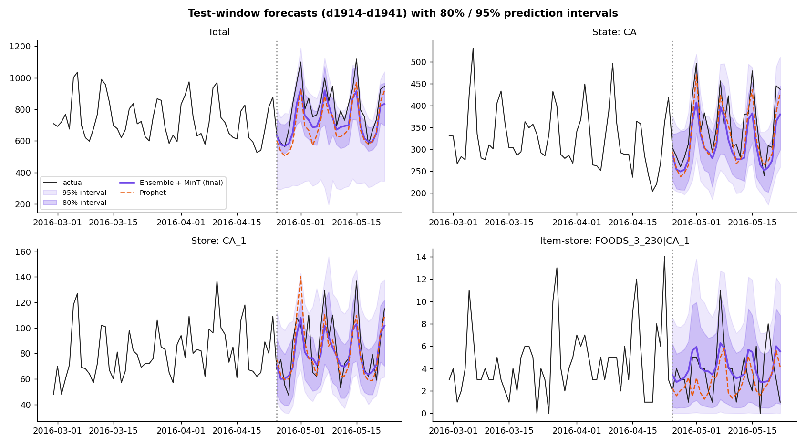
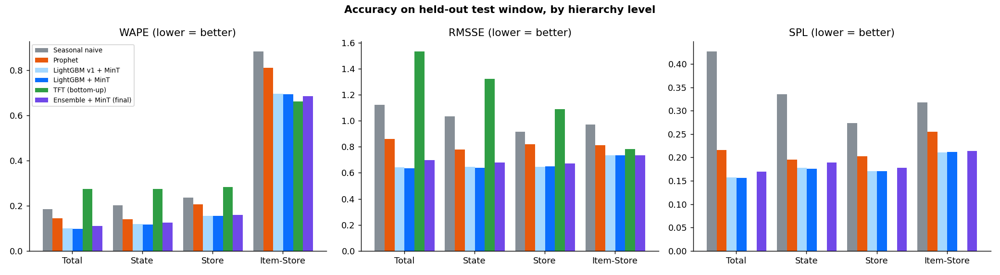
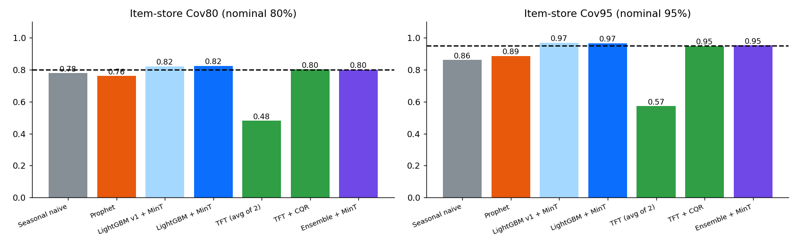
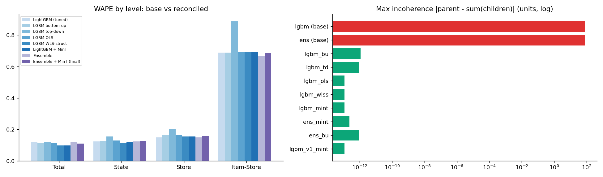

# Results (generated by `scripts/make_report.py` from `results/*.csv|json` - do not edit by hand)

All accuracy numbers are on the **held-out test window d1914-d1941** (28 days). **No model choice, hyper-parameter, blend weight or conformal adjustment was selected on the test window**:
features/hyper-parameters were selected on a separate window (d1858-d1885, models trained <= d1857), blend weight / MinT weights / conformal adjustments / copula rho on the calibration window (d1886-d1913).
Scope: 40 items x 10 stores x 3 states = 400 bottom series, 414 hierarchy nodes (see `docs/DATA.md`).

## 1. Point-forecast accuracy by hierarchy level
| model | WAPE Total | WAPE State | WAPE Store | WAPE Item-Store | RMSSE Total | RMSSE State | RMSSE Store | RMSSE Item-Store |
|---|---|---|---|---|---|---|---|---|
| Naive | 0.163 | 0.197 | 0.244 | 1.013 | 1.046 | 0.986 | 0.894 | 1.014 |
| Seasonal naive | 0.185 | 0.202 | 0.236 | 0.884 | 1.122 | 1.033 | 0.917 | 0.971 |
| Prophet | 0.143 | 0.140 | 0.205 | 0.812 | 0.860 | 0.780 | 0.820 | 0.812 |
| LightGBM v1 + MinT | 0.099 | 0.119 | 0.155 | 0.696 | 0.642 | 0.644 | 0.647 | 0.736 |
| LightGBM + MinT | 0.098 | 0.117 | 0.155 | 0.694 | 0.635 | 0.638 | 0.649 | 0.734 |
| TFT (avg of 2) |  |  |  | 0.662 |  |  |  | 0.782 |
| TFT (bottom-up) | 0.275 | 0.275 | 0.283 | 0.662 | 1.533 | 1.321 | 1.090 | 0.782 |
| Ensemble + MinT (final) | 0.110 | 0.126 | 0.160 | 0.685 | 0.698 | 0.680 | 0.670 | 0.734 |

WAPE = sum|y-yhat|/sum y (pooled within level). RMSSE = M5 definition (scale = one-step naive MSE on history, mean over series at that level).
"LightGBM v1 + MinT" is the previous version of this project (base features, default parameters) kept as an archived baseline for before/after comparison.

### Are the differences real? Paired bootstrap over series (2,000 resamples), pooled item-store WAPE (positive = the second model is better)
| comparison | mean difference | 95% CI |
|---|---|---|
| WAPE(prophet) - WAPE(ens_mint) | +0.127 | [+0.083, +0.174] |
| WAPE(snaive) - WAPE(ens_mint) | +0.199 | [+0.154, +0.240] |
| WAPE(lgbm_v1_mint) - WAPE(ens_mint) | +0.011 | [+0.001, +0.020] |
| WAPE(lgbm_v1_mint) - WAPE(lgbm_mint) | +0.002 | [-0.006, +0.009] |
| WAPE(lgbm_mint) - WAPE(ens_mint) | +0.010 | [+0.001, +0.017] |
| WAPE(tft_avg) - WAPE(ens_mint) | -0.023 | [-0.051, +0.001] |

## 2. Prediction intervals (item-store level, test window)
| model | SPL | Cov80 | Cov95 | Width80 | WRMSSE |
|---|---|---|---|---|---|
| Seasonal naive | 0.317 | 0.779 | 0.861 | 3.482 | 0.974 |
| Prophet | 0.255 | 0.761 | 0.887 | 3.781 | 0.813 |
| LightGBM v1 + MinT | 0.210 | 0.821 | 0.969 | 4.260 | 0.741 |
| LightGBM + MinT | 0.212 | 0.824 | 0.967 | 4.237 | 0.740 |
| LightGBM + CQR | 0.212 | 0.824 | 0.967 | 4.237 | 0.738 |
| TFT (avg of 2) | 0.228 | 0.481 | 0.572 | 3.785 | 0.755 |
| TFT + CQR | 0.228 | 0.802 | 0.948 | 3.786 | 0.755 |
| Ensemble | 0.213 | 0.801 | 0.953 | 4.102 | 0.732 |
| Ensemble + MinT (final) | 0.213 | 0.801 | 0.953 | 4.102 | 0.737 |

Cov80/Cov95 = empirical coverage of the nominal 80% / 95% interval. SPL = scaled pinball loss (M5-uncertainty style; lower is better).
**Recalibration** = locally-weighted conformalised quantile regression fitted on the calibration window, pooled over 400 series x 28 days, bottom level only
(14 aggregate nodes x 28 correlated days are too few). Learned adjustments (in units of interval width + 1): LightGBM {"0.1-0.9": 0.0, "0.025-0.975": 0.0},
TFT {"0.1-0.9": 0.0, "0.025-0.975": 0.0}, ensemble {"0.1-0.9": 0.0, "0.025-0.975": 0.0}.

## 3. Hierarchical reconciliation (Darts)
| model | Total | State | Store | Item-Store |
|---|---|---|---|---|
| LightGBM (tuned) | 0.121 | 0.124 | 0.149 | 0.688 |
| LGBM bottom-up | 0.113 | 0.126 | 0.163 | 0.688 |
| LGBM top-down | 0.121 | 0.156 | 0.202 | 0.888 |
| LGBM OLS | 0.113 | 0.129 | 0.165 | 0.694 |
| LGBM WLS-struct | 0.098 | 0.115 | 0.155 | 0.693 |
| LightGBM + MinT | 0.098 | 0.117 | 0.155 | 0.694 |
| Ensemble | 0.121 | 0.124 | 0.149 | 0.669 |
| Ensemble + MinT (final) | 0.110 | 0.126 | 0.160 | 0.685 |

Coherence audit (max absolute gap, units):

| forecast | store = sum(items) | state = sum(stores) | total = sum(states) |
|---|---|---|---|
| lgbm (base, unreconciled) | 3.78e+01 | 4.48e+01 | 7.96e+01 |
| ens (base, unreconciled) | 4.07e+01 | 4.48e+01 | 7.96e+01 |
| lgbm_bu (bottom_up) | 0.00e+00 | 3.41e-13 | 1.14e-12 |
| lgbm_td (top_down) | 2.84e-14 | 3.41e-13 | 9.09e-13 |
| lgbm_ols (ols) | 5.68e-14 | 5.68e-14 | 1.14e-13 |
| lgbm_wlss (wls_struct) | 5.68e-14 | 5.68e-14 | 1.14e-13 |
| lgbm_mint (wls_var) | 5.68e-14 | 5.68e-14 | 1.14e-13 |
| ens_mint (wls_var) | 8.53e-14 | 1.14e-13 | 2.27e-13 |
| ens_bu (bottom_up) | 0.00e+00 | 3.41e-13 | 9.09e-13 |
| lgbm_v1_mint (wls_var) | 5.68e-14 | 1.14e-13 | 1.14e-13 |

## 4. Where do the models win / lose? (WAPE by segment)
| group | Ensemble + MinT (final) | LightGBM v1 + MinT | Prophet | Seasonal naive | TFT (avg of 2) |
|---|---|---|---|---|---|
| FOODS | 0.660 | 0.670 | 0.817 | 0.871 | 0.637 |
| HOBBIES | 0.863 | 0.875 | 0.900 | 1.076 | 0.826 |
| HOUSEHOLD | 0.652 | 0.668 | 0.748 | 0.810 | 0.637 |
| intermittent (30-60%) | 0.842 | 0.843 | 1.028 | 0.971 | 0.781 |
| smooth (<30% zero days) | 0.556 | 0.565 | 0.663 | 0.793 | 0.567 |
| sparse (>=60%) | 1.169 | 1.242 | 1.227 | 1.325 | 1.005 |

## 5. Inventory optimisation (OR-Tools), 4-week rolling backtest on the real test window
Primary forecast source: **Ensemble + MinT**. Copula correlation chosen on the calibration window: rho = 0.2 (80%-interval coverage of 7-day demand by rho: {"0.0": 0.628, "0.2": 0.772, "0.4": 0.83, "0.6": 0.861, "0.8": 0.876, "1.0": 0.912}).
| model | policy | cost | fill_rate | stockout_rate | avg_end_inv_value | order_value |
|---|---|---|---|---|---|---|
| Ensemble + MinT | mean | 11485.367 | 0.606 | 0.739 | 95.953 | 31865.974 |
| Ensemble + MinT | milp | 5842.364 | 0.798 | 0.347 | 298.723 | 44564.169 |
| Ensemble + MinT | oracle | 448.611 | 1.000 | 0.000 | 186.921 | 52511.374 |
| Ensemble + MinT | safety | 10224.450 | 0.644 | 0.603 | 169.181 | 35108.150 |
| LightGBM + MinT | mean | 10973.831 | 0.613 | 0.696 | 99.598 | 32795.553 |
| LightGBM + MinT | milp | 6097.711 | 0.788 | 0.347 | 305.516 | 44202.787 |
| LightGBM + MinT | oracle | 448.611 | 1.000 | 0.000 | 186.921 | 52511.374 |
| LightGBM + MinT | safety | 10304.877 | 0.636 | 0.587 | 172.860 | 34966.554 |
| LightGBM v1 + MinT | mean | 10928.699 | 0.613 | 0.676 | 109.618 | 32917.836 |
| LightGBM v1 + MinT | milp | 6087.385 | 0.788 | 0.354 | 307.154 | 44262.476 |
| LightGBM v1 + MinT | oracle | 448.611 | 1.000 | 0.000 | 186.921 | 52511.374 |
| LightGBM v1 + MinT | safety | 10594.045 | 0.624 | 0.599 | 176.667 | 34588.722 |
| Prophet | mean | 12460.357 | 0.545 | 0.655 | 171.960 | 31239.124 |
| Prophet | milp | 7126.596 | 0.749 | 0.355 | 369.378 | 43751.413 |
| Prophet | oracle | 448.611 | 1.000 | 0.000 | 186.921 | 52511.374 |
| Prophet | safety | 11192.437 | 0.591 | 0.579 | 217.930 | 34310.570 |
| Seasonal naive | mean | 8928.408 | 0.671 | 0.439 | 264.708 | 38699.346 |
| Seasonal naive | milp | 6895.406 | 0.755 | 0.272 | 495.839 | 45925.284 |
| Seasonal naive | oracle | 448.611 | 1.000 | 0.000 | 186.921 | 52511.374 |
| Seasonal naive | safety | 9904.728 | 0.643 | 0.505 | 245.883 | 36632.162 |
| TFT (recalibrated) | mean | 8208.120 | 0.708 | 0.542 | 203.800 | 38966.158 |
| TFT (recalibrated) | milp | 5712.322 | 0.808 | 0.350 | 302.469 | 45096.337 |
| TFT (recalibrated) | oracle | 448.611 | 1.000 | 0.000 | 186.921 | 52511.374 |
| TFT (recalibrated) | safety | 10307.228 | 0.646 | 0.656 | 180.237 | 35189.539 |

Budget sensitivity (Ensemble + MinT scenarios):

| budget_factor | policy | cost | fill_rate | stockout_rate |
|---|---|---|---|---|
| 0.850 | milp | 8048.451 | 0.710 | 0.504 |
| 0.850 | safety | 13012.697 | 0.548 | 0.716 |
| 0.950 | milp | 6746.634 | 0.759 | 0.412 |
| 0.950 | safety | 11206.192 | 0.607 | 0.646 |
| 1.050 | milp | 5893.849 | 0.799 | 0.348 |
| 1.050 | safety | 10210.224 | 0.645 | 0.601 |
| 1.250 | milp | 4692.251 | 0.854 | 0.239 |
| 1.250 | safety | 8722.597 | 0.701 | 0.525 |
| 10.000 | milp | 3820.564 | 0.913 | 0.109 |
| 10.000 | safety | 5404.714 | 0.844 | 0.307 |

## 6. How the model was optimised, and what actually generalised
**Stage 1 - search on a separate selection window** (d1858-d1885, models trained <= d1857; never the test window). The extended feature set and a random search over 8 hyper-parameter sets were tried;
the best search result ("B_tuned") scored WAPE 0.6866 / RMSSE 0.6972 vs baseline 0.7008 / 0.7022 there.

| name | n_feats | WAPE | RMSSE | best_iter | num_leaves | min_data_in_leaf | feature_fraction | lambda_l2 | tweedie_variance_power |
|---|---|---|---|---|---|---|---|---|---|
| base_features/default | 39 | 0.7008 | 0.7022 | 289 | 63 | 60 | 0.7 | 1 | 1.15 |
| ext_features/default | 49 | 0.6976 | 0.6994 | 389 | 63 | 60 | 0.7 | 1 | 1.15 |
| random_0 | 49 | 0.6903 | 0.6981 | 220 | 255 | 120 | 0.7 | 0 | 1.15 |
| random_1 | 49 | 0.6866 | 0.6972 | 407 | 31 | 30 | 0.5 | 0 | 1.5 |
| random_2 | 49 | 0.6911 | 0.6992 | 170 | 127 | 250 | 0.7 | 1 | 1.5 |
| random_3 | 49 | 0.6986 | 0.7013 | 99 | 127 | 120 | 0.7 | 1 | 1.5 |
| random_4 | 49 | 0.7044 | 0.7027 | 482 | 63 | 250 | 0.9 | 0 | 1.15 |
| random_5 | 49 | 0.6894 | 0.6978 | 169 | 255 | 120 | 0.5 | 10 | 1.3 |
| random_6 | 49 | 0.703 | 0.701 | 264 | 255 | 30 | 0.5 | 10 | 1.05 |
| random_7 | 49 | 0.704 | 0.7008 | 220 | 127 | 30 | 0.5 | 1 | 1.15 |

**Stage 2 - rolling-origin check with a decision rule fixed in advance.** A 28-day window is a noisy judge, so the configurations were re-evaluated on four *clean* earlier windows
(d1718-1829; out-of-sample for the search, for early stopping and for the test window; fixed tree counts, trained strictly before each window).
Rule: adopt the config with the lowest mean of 0.5*(WAPE/WAPE_v1 + RMSSE/RMSSE_v1), only if it beats v1 by >= 0.2%.

| kind | window | RMSSE A_v1 | RMSSE B_tuned | RMSSE C_ext_default | WAPE A_v1 | WAPE B_tuned | WAPE C_ext_default |
|---|---|---|---|---|---|---|---|
| clean (decision) | d1718-1745 | 0.6859 | 0.6912 | 0.6841 | 0.7325 | 0.7575 | 0.7276 |
| clean (decision) | d1746-1773 | 0.7105 | 0.7144 | 0.7105 | 0.7453 | 0.7585 | 0.7472 |
| clean (decision) | d1774-1801 | 0.6741 | 0.6775 | 0.6726 | 0.7591 | 0.7648 | 0.7587 |
| clean (decision) | d1802-1829 | 0.7135 | 0.7097 | 0.7100 | 0.7204 | 0.7095 | 0.7128 |
| report only | d1858-1885 | 0.7011 | 0.7013 |  | 0.7026 | 0.6988 |  |
| report only | d1886-1913 | 0.7129 | 0.7107 |  | 0.7510 | 0.7441 |  |
| report only | d1914-1941 | 0.7346 | 0.7464 |  | 0.6924 | 0.7361 |  |

Scores vs v1 (lower is better): {"A_v1": 1.0, "B_tuned": 1.0071, "C_ext_default": 0.9968} -> **adopted: C_ext_default**
(A_v1 = base features + default params; B_tuned = searched params; C_ext_default = extended features + default params).
Finding: the searched hyper-parameters did not generalise (worse than v1 on 3 of 4 clean windows and on the test window), while the extended features gave a small gain on most clean windows (RMSSE better on 3 of 4 with one tie, WAPE better on 3 of 4).
The "report only" rows show the selection, calibration and test windows for transparency; they were not used for the decision.

**Disclosure.** The tuned configuration's test-window score was viewed once *before* the rolling-origin check was run, and it was worse than v1. The check was therefore designed so that its
decision rule (written into `scripts/rolling_origin_lgbm.py` before running) uses only the four clean windows d1718-d1829, never the test window. The ensemble design (two TFTs averaged, blend weight from the calibration window)
and the choice of the ensemble as the final model were fixed before test results for them were produced. No parameter was changed after seeing the final test results.

Ensemble: TFT weight **0.3** (chosen on the calibration window by minimising WAPE/WAPE_lgbm + RMSSE/RMSSE_lgbm; grid: {"0.0": 2.0, "0.1": 1.9917, "0.2": 1.9865, "0.3": 1.9841, "0.4": 1.9844, "0.5": 1.9876, "0.6": 1.9934, "0.7": 2.002, "0.8": 2.0128, "0.9": 2.026, "1.0": 2.0414}).

## 7. Training details
* LightGBM bottom model: best iteration 352 (early-stopped on calibration window), aggregate model 80; quantile heads 5 x <=350 trees.
* TFT-1: 10 max epochs x 400 batches, hidden 16, heads 2, dropout 0.1, 672 s on 1 CPU.
* TFT-2: 10 max epochs x 400 batches, hidden 24, heads 4, dropout 0.15, 849 s on 1 CPU. TFT forecasts used = equal average of TFT-1 and TFT-2.
