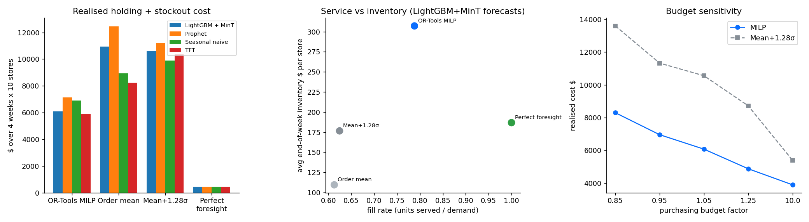
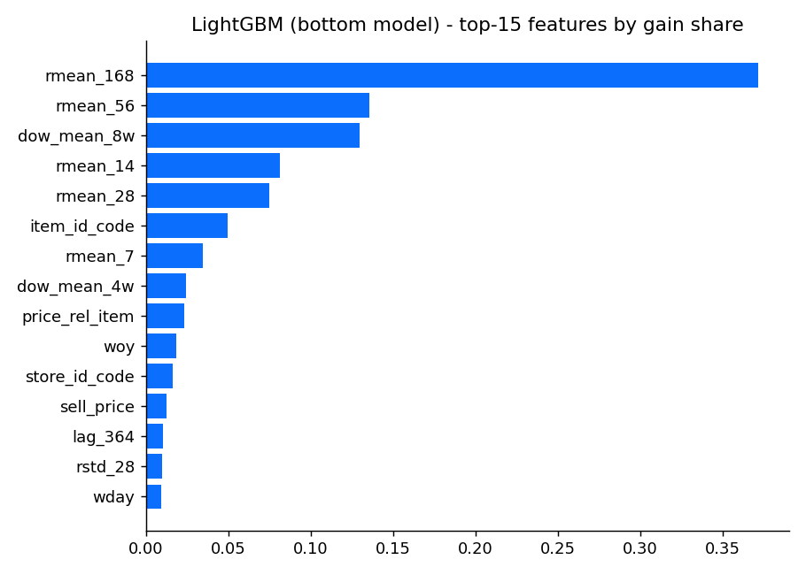

# Results (generated by `scripts/make_report.py` from `results/*.csv|json` - do not edit by hand)

All accuracy numbers are on the **held-out test window d1914-d1941** (28 days; never used for training, tuning, calibration or model selection).
Scope: 40 items x 10 stores x 3 states = 400 bottom series, 414 hierarchy nodes (see `docs/DATA.md`).

## 1. Point-forecast accuracy by hierarchy level
| model | WAPE Total | WAPE State | WAPE Store | WAPE Item-Store | RMSSE Total | RMSSE State | RMSSE Store | RMSSE Item-Store |
|---|---|---|---|---|---|---|---|---|
| LightGBM (base) | 0.121 | 0.124 | 0.149 | 0.689 | 0.755 | 0.665 | 0.620 | 0.735 |
| LightGBM+MinT | 0.099 | 0.119 | 0.155 | 0.696 | 0.642 | 0.644 | 0.647 | 0.736 |
| Naive | 0.163 | 0.197 | 0.244 | 1.013 | 1.046 | 0.986 | 0.894 | 1.014 |
| Prophet | 0.143 | 0.140 | 0.205 | 0.812 | 0.860 | 0.780 | 0.820 | 0.812 |
| Seasonal naive | 0.185 | 0.202 | 0.236 | 0.884 | 1.122 | 1.033 | 0.917 | 0.971 |
| TFT |  |  |  | 0.658 |  |  |  | 0.777 |
| TFT (bottom-up) | 0.265 | 0.265 | 0.277 | 0.658 | 1.482 | 1.288 | 1.071 | 0.777 |

WAPE = sum|y-yhat|/sum y (pooled within level). RMSSE = M5 definition (scale = one-step naive MSE on history, mean over series at that level).
Revenue-weighted item-store WRMSSE: Naive 1.084, Seasonal naive 0.974, Prophet 0.813, LightGBM (base) 0.740, LightGBM+MinT 0.741, TFT 0.753.

### Is the difference real? Paired bootstrap over series (2,000 resamples) of pooled item-store WAPE
| comparison | mean difference | 95% CI |
|---|---|---|
| WAPE(prophet) - WAPE(lgbm_mint) | +0.116 | [+0.076, +0.162] |
| WAPE(snaive) - WAPE(lgbm_mint) | +0.188 | [+0.145, +0.228] |
| WAPE(lgbm) - WAPE(lgbm_mint) | -0.007 | [-0.018, -0.000] |
| WAPE(tft) - WAPE(lgbm_mint) | -0.038 | [-0.068, -0.014] |
| WAPE(prophet) - WAPE(tft) | +0.155 | [+0.111, +0.207] |

## 2. Prediction intervals (item-store level, test window)
| model | SPL | Cov80 | Cov95 | Width80 | WRMSSE |
|---|---|---|---|---|---|
| Naive | 0.484 | 0.610 | 0.676 | 2.771 | 1.084 |
| Seasonal naive | 0.317 | 0.779 | 0.861 | 3.482 | 0.974 |
| Prophet | 0.254 | 0.761 | 0.892 | 3.783 | 0.813 |
| LightGBM (base) | 0.210 | 0.821 | 0.969 | 4.260 | 0.740 |
| LightGBM+MinT | 0.210 | 0.821 | 0.969 | 4.260 | 0.741 |
| TFT | 0.231 | 0.469 | 0.563 | 3.637 | 0.753 |

Cov80/Cov95 = empirical coverage of the nominal 80% / 95% interval (nominal = 0.80 / 0.95). SPL = scaled pinball loss (M5-uncertainty style, lower is better).
Conformalised-quantile-regression adjustment learnt on the calibration window = {"0.1-0.9": {"bottom": 0.0}, "0.025-0.975": {"bottom": 0.0}} - i.e. the native LightGBM quantile heads were already valid at the bottom level, so no change was made (CQR was *not* applied to the 14 aggregate nodes: 28 correlated days per node is too small a calibration sample - a first attempt reduced Total 80%-coverage from 0.64 to 0.39).

## 3. Hierarchical reconciliation (Darts)
| model | Total | State | Store | Item-Store |
|---|---|---|---|---|
| LGBM OLS | 0.113 | 0.129 | 0.165 | 0.696 |
| LGBM WLS-struct | 0.098 | 0.117 | 0.155 | 0.695 |
| LGBM bottom-up | 0.119 | 0.131 | 0.167 | 0.689 |
| LGBM top-down | 0.121 | 0.156 | 0.202 | 0.888 |
| LightGBM (base) | 0.121 | 0.124 | 0.149 | 0.689 |
| LightGBM+MinT | 0.099 | 0.119 | 0.155 | 0.696 |

Coherence audit (max absolute gap, units):

| forecast | store = sum(items) | state = sum(stores) | total = sum(states) |
|---|---|---|---|
| lgbm (base, unreconciled) | 4.68e+01 | 4.48e+01 | 7.96e+01 |
| lgbm_bu (bottom_up) | 0.00e+00 | 2.84e-13 | 9.09e-13 |
| lgbm_td (top_down) | 1.42e-14 | 3.41e-13 | 9.09e-13 |
| lgbm_ols (ols) | 5.68e-14 | 5.68e-14 | 1.14e-13 |
| lgbm_wlss (wls_struct) | 5.68e-14 | 1.14e-13 | 1.14e-13 |
| lgbm_mint (wls_var) | 5.68e-14 | 1.14e-13 | 1.14e-13 |

## 4. Where do the models win / lose? (WAPE by segment)
| group | LightGBM+MinT | Prophet | Seasonal naive | TFT |
|---|---|---|---|---|
| FOODS | 0.670 | 0.817 | 0.871 | 0.631 |
| HOBBIES | 0.875 | 0.900 | 1.076 | 0.824 |
| HOUSEHOLD | 0.668 | 0.748 | 0.810 | 0.639 |
| intermittent (30-60%) | 0.843 | 1.028 | 0.971 | 0.766 |
| smooth (<30% zero days) | 0.565 | 0.663 | 0.793 | 0.568 |
| sparse (>=60%) | 1.242 | 1.227 | 1.325 | 1.005 |

## 5. Inventory optimisation (OR-Tools), 4-week rolling backtest on the real test window
Copula correlation chosen on the calibration window: rho = 0.2 (80%-interval coverage of 7-day demand by rho: {"0.0": 0.636, "0.2": 0.777, "0.4": 0.839, "0.6": 0.866, "0.8": 0.885, "1.0": 0.923}).
| model | policy | cost | fill_rate | stockout_rate | avg_end_inv_value | order_value |
|---|---|---|---|---|---|---|
| LightGBM + MinT | mean | 10928.699 | 0.613 | 0.676 | 109.618 | 32917.836 |
| LightGBM + MinT | milp | 6087.385 | 0.788 | 0.354 | 307.154 | 44262.476 |
| LightGBM + MinT | oracle | 448.611 | 1.000 | 0.000 | 186.921 | 52511.374 |
| LightGBM + MinT | safety | 10594.045 | 0.624 | 0.599 | 176.667 | 34588.722 |
| Prophet | mean | 12176.495 | 0.557 | 0.636 | 190.979 | 31869.131 |
| Prophet | milp | 7105.061 | 0.749 | 0.354 | 372.404 | 43792.482 |
| Prophet | oracle | 448.611 | 1.000 | 0.000 | 186.921 | 52511.374 |
| Prophet | safety | 11158.897 | 0.594 | 0.573 | 223.047 | 34383.510 |
| Seasonal naive | mean | 8928.408 | 0.671 | 0.439 | 264.708 | 38699.346 |
| Seasonal naive | milp | 6895.406 | 0.755 | 0.272 | 495.839 | 45925.284 |
| Seasonal naive | oracle | 448.611 | 1.000 | 0.000 | 186.921 | 52511.374 |
| Seasonal naive | safety | 9904.728 | 0.643 | 0.505 | 245.883 | 36632.162 |
| TFT | mean | 8251.712 | 0.705 | 0.540 | 201.125 | 38842.405 |
| TFT | milp | 5879.269 | 0.806 | 0.361 | 287.985 | 44428.600 |
| TFT | oracle | 448.611 | 1.000 | 0.000 | 186.921 | 52511.374 |
| TFT | safety | 10392.578 | 0.638 | 0.657 | 170.769 | 34760.880 |

Budget sensitivity (LightGBM+MinT scenarios):

| budget_factor | policy | cost | fill_rate | stockout_rate |
|---|---|---|---|---|
| 0.850 | milp | 8297.556 | 0.697 | 0.500 |
| 0.850 | safety | 13599.728 | 0.523 | 0.714 |
| 0.950 | milp | 6955.985 | 0.749 | 0.417 |
| 0.950 | safety | 11328.196 | 0.598 | 0.626 |
| 1.050 | milp | 6073.428 | 0.787 | 0.340 |
| 1.050 | safety | 10557.742 | 0.626 | 0.597 |
| 1.250 | milp | 4875.103 | 0.844 | 0.238 |
| 1.250 | safety | 8719.609 | 0.694 | 0.485 |
| 10.000 | milp | 3895.254 | 0.906 | 0.117 |
| 10.000 | safety | 5392.726 | 0.836 | 0.294 |

## 6. Feature importance

## 7. Training details
* LightGBM: bottom model best iteration 513 (early-stopped on calibration window), aggregate model 80; quantile heads 5 x <=350 trees.
* TFT: 10 epochs x 400 batches, 705 s on 1 CPU, 33.8k parameters.
